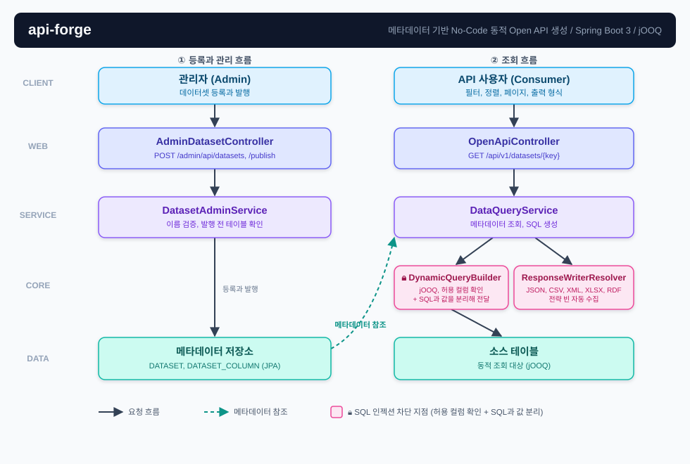

# 개방DB API관리: 메타데이터 기반 조회 API 엔진

<nav class="project-page-nav" aria-label="개방DB API관리 프로젝트 목차">
  <a href="#company">
    <span>회사 프로젝트</span>
    <small>목표, 담당, 적용 범위</small>
  </a>
  <a href="#reimplementation">
    <span>개인 프로젝트: api-forge</span>
    <small>쿼리 조합 부분만 재구현</small>
  </a>
  <a href="#engine">
    <span>01. 엔진이 하는 일</span>
    <small>데이터셋 등록 한 건 = API 하나</small>
  </a>
  <a href="#injection">
    <span>02. 인젝션 차단</span>
    <small>허용 목록으로 요청 검증</small>
  </a>
  <a href="#legacy">
    <span>03. 선택 이유</span>
    <small>구현 방식과 선택 기준</small>
  </a>
  <a href="#limitations">
    <span>마무리</span>
    <small>확인한 범위와 남은 과제</small>
  </a>
</nav>

## 회사 프로젝트 {#company}

<span class="project-context">회사 프로젝트 / 2024.09 ~ 2025.01 / Java 8, Spring MVC, eGovFrame, MyBatis, MariaDB</span>

개방DB API관리는 개방데이터를 조회 API로 외부에 공개하는 시스템입니다. 기존 서비스는 요구사항이 하나 늘 때마다 조회 API도 하나씩 늘어나는 구조여서 매번 개발자가 개입해야 했습니다. 이 프로젝트는 기존 서비스를 고도화하는 일이 아니라, 앞으로 들어올 프로젝트에서 가져다 쓸 수 있는 기본 틀로 다시 만드는 일이었습니다. 기존 코드는 리팩토링해서 실제로 쓸 기능만 남기고 쓰지 않던 함수와 중복 모듈을 덜어냈고, 정리되지 않은 프로퍼티와 읽기 힘든 주석도 손봤습니다. 조회 API를 만드는 부분은 메타데이터로 조합하는 엔진을 새로 설계했습니다. 필수 기능이 매끄럽게 동작하면서 코드를 쉽게 파악할 수 있는 구조를 기준으로 삼았고, 개발자가 매번 개입하지 않아도 사용자가 직접 조회 API를 조합할 수 있게 했습니다. 기존 레거시는 Tibero를 썼고, 회사 주 사용 DB인 MariaDB로 함께 옮겼습니다.

저는 3인 팀에서 화면과 API 설계, 메타데이터(조회 대상, 컬럼, 검색 조건을 담은 설정 데이터) 구조 설계, 동적 쿼리 엔진 구현을 맡았습니다.

기존 방식에서는 조회 API 하나를 추가하려면 Controller, Service, DAO, SQL XML 등 파일 5~6개(작성자 경험 기준)를 새로 쓰고 재배포해야 했습니다. 파라미터가 Map으로 오가서 컴파일 단계의 검증이 없었고, 입력 검증과 바인딩(SQL과 값을 분리해 전달)을 빠뜨릴 수 있는 자리가 API마다 있었습니다. 외부에 공개하는 API라서 누락 하나가 곧 SQL 인젝션 통로가 될 수 있었습니다.

그래서 API를 코드로 만들지 않고, 어떤 테이블의 어떤 컬럼을 어떤 조건으로 조회할지를 데이터로 적어 두면 엔진이 쿼리를 조립하게 했습니다. 조회 API 하나가 메타데이터 한 건의 등록과 발행으로 바뀌어, 추가할 때 빌드와 재배포가 필요 없고 검증과 바인딩도 엔진 한 곳에 모였습니다.

담당 기간에는 개발 서버 적용까지 완료했습니다. 운영에는 반영하지 못했습니다.

### 회사 프로젝트와 api-forge는 이렇게 구분됩니다

| 구분 | 회사 프로젝트 | 개인 프로젝트 api-forge |
| :--- | :--- | :--- |
| 기간 | 2024.09 ~ 2025.01 | 2026.07 ~ 진행 중 |
| 한 일 | 3인 팀에서 화면과 API 설계, 메타데이터 구조 설계, 동적 쿼리 엔진 구현 | 회사 구현 중 쿼리를 조합하는 부분만 직접 다시 구현 |
| 구현에 포함된 기능 | 쿼리 조합 엔진, 샘플 URL 호출 검증, 호출 통계 대시보드, 권한 분리, v1/v2 버전 체계 | 쿼리 조합 엔진만 |
| 사용 DB | MariaDB (기존 Tibero에서 이전) | H2, PostgreSQL |
| 기술 | Java 8, Spring MVC, eGovFrame, MyBatis | Java 21, Spring Boot 3.5, jOOQ, Testcontainers |
| 확인한 범위 | 개발 서버 적용까지. 운영 반영과 실트래픽 검증은 없음 | 단위 및 통합 테스트, CI. 부하 테스트는 없음 |
| 아래 코드와 테스트 | 회사 코드는 가져오지 않음 | 모두 api-forge에서 나옴 |
{: .api-design-comparison}

## 개인 프로젝트: api-forge {#reimplementation}

<span class="project-context">개인 프로젝트 / 2026.07 ~ 진행 중 / Java 21, Spring Boot 3.5, jOOQ, Testcontainers, CI</span>

회사에서 운영 검증까지 가지 못한 설계가 실제로 성립하는지 확인하려고, 회사 코드를 가져오지 않고 설계 의도만 옮겨 쿼리 조합 부분을 다시 구현했습니다. 테이블명과 컬럼명은 등록된 것만 허용하고, 공격 입력을 넣는 테스트를 CI(코드 변경 시 자동 빌드와 테스트)에서 실행해 SQL 인젝션 차단을 확인합니다.

### 01. 엔진이 하는 일: 데이터셋 등록 한 건이 API 하나 {#engine}

- **`DATASET`** 조회 대상 테이블과 URL 키를 정의합니다.
- **`DATASET_COLUMN`** 노출 컬럼과 허용 필터와 정렬을 정의하며, 여기 등록된 컬럼만 조회, 필터, 정렬에 쓸 수 있습니다.
- **연산자** 컬럼의 `filterType`이 정하고, 클라이언트는 고르지 못합니다. 관리자는 미리 정한 유형 5개 중 하나를 고를 뿐 연산자 문자열을 입력하지 않으므로, 관리 API로는 임의의 SQL 조각을 넣을 수 없습니다. 허용할 이름과 필터 유형은 메타데이터를 등록할 때부터 검증합니다.
- **표의 범위** 아래 표는 예시입니다. `WORDS`는 대소문자를 구분하지 않고, `DATE`는 날짜 하나만 보내면 `=`로 비교합니다.
- **유형 이름** 공공데이터포털의 검색 UI를 기준으로 붙였습니다. `WORDS`는 검색어 입력창, `CHECK`는 체크박스 필터에 대응합니다.
- **샘플 데이터** 도서관 장서를 가정한 가상 데이터입니다. 컬럼명은 영문약어 규칙으로 지었습니다(`NM`=명, `DT`=일자).

| sourceColumn | displayName | filterType | sortable | 요청 예시 |
| :--- | :--- | :--- | :--- | :--- |
| **BOOK_ID** | 도서번호 | EQUALS (=) | 가능 | `?BOOK_ID=1000012` |
| **BOOK_NM** | 도서명 | WORDS (LIKE) | 불가 | `?BOOK_NM=데이터` |
| **CATEGORY** | 분류 | CHECK (IN) | 가능 | `?CATEGORY=컴퓨터,과학` |
| **PUBLISH_DT** | 발행일자 | DATE (BETWEEN) | 가능 | `?PUBLISH_DT=2025-01-01,2025-06-30` |
| **BOOK_STATUS** | 대출상태 | NONE (필터 불가) | 불가 | 응답에는 나오지만 값을 넣어 조건으로 쓰면 `400` |
{: .api-query-columns}

```
GET /api/v1/datasets/books?CATEGORY=컴퓨터,과학&PUBLISH_DT=2025-01-01,2025-06-30&sort=PUBLISH_DT,desc&page=0&size=20
```

```sql
SELECT "BOOK_ID", "BOOK_NM", "AUTHOR", "CATEGORY", "PUBLISH_DT", "BOOK_STATUS"
FROM "LIB_BOOK"
WHERE "CATEGORY" IN (?, ?)
  AND "PUBLISH_DT" BETWEEN ? AND ?
ORDER BY "PUBLISH_DT" DESC
LIMIT 20 OFFSET 0
-- 바인드 값: '컴퓨터', '과학', 2025-01-01, 2025-06-30
```

{:.portfolio-diagram}

### 02. 인젝션 차단: 방어 지점이 엔진 한 곳 {#injection}

인증을 통과한 조회 요청에서, 필터 이름과 값은 서로 다른 경로로 처리합니다. 아래는 값이 있는 필터를 처리하는 흐름입니다.



- **SQL에 들어가는 테이블명과 컬럼명** 메타데이터에 저장된 컬럼명과 테이블명만 씁니다. 테이블명과 컬럼명은 등록할 때 이름에 허용된 문자만 있는지 검증하고, `DSL.name`으로 SQL 명령이 아닌 이름으로 처리합니다.
- **요청 파라미터명** 등록된 컬럼을 찾는 데만 쓰며, SQL에 직접 넣지 않습니다.
- **정렬** 등록된 컬럼 중 `sortable`인 것만 받고, 방향은 asc와 desc 둘뿐입니다.
- **값** SQL 문장에 이어 붙이지 않고 별도 파라미터로 전달합니다(바인딩).
- **효과** 검증과 바인드 누락이 생길 수 있는 지점이 API 개수만큼에서 엔진 한 곳으로 줄었습니다.

```java
DatasetColumn col = dataset.findColumn(paramName)
        .orElseThrow(() -> new InvalidQueryException("지원하지 않는 필터 파라미터입니다: " + paramName));
if (col.getFilterType() == FilterType.NONE) {
    throw new InvalidQueryException("필터가 허용되지 않은 칼럼입니다: " + paramName);
}
Field<Object> field = DSL.field(DSL.name(col.getSourceColumn())); // SQL에는 메타데이터의 컬럼명만 들어간다
```

이 방어가 실제 공격 입력에서 성립하는지 `main` 푸시와 PR마다 CI에서 확인합니다.

| 공격 시나리오 | 결과 |
| :--- | :--- |
| 미등록 컬럼으로 필터 요청 | `400`으로 거부합니다. |
| `BOOK_ID; DROP TABLE ...` 파라미터명 위장 | `400`으로 거부합니다. |
| `' OR '1'='1` 값 주입 | SQL 명령이 아닌 문자열 값으로 전달합니다. |

- **단위 테스트** 세 시나리오 모두 SQL 조립기 단위 테스트로 검증합니다.
- **통합 테스트** 등록부터 발행, 조회까지의 전체 흐름을 MockMvc로 검증합니다. 미등록 컬럼과 값 주입 두 시나리오는 H2와 PostgreSQL(Testcontainers)에서 같은 방식으로 확인하고, 파라미터명 위장은 단위 테스트에서만 확인합니다.

### 03. 선택 이유 {#legacy}

<details markdown="1">
<summary>jOOQ, 입력 구조, 페이징, DB 방언을 어떤 기준으로 골랐는지 보기</summary>

재구현에서는 입력 오류를 발견하기 쉬운지, 검증 누락을 줄일 수 있는지, DB별 SQL을 중복 관리하지 않아도 되는지를 기준으로 구현 방식을 선택했습니다.

| 선택한 방식 | 비교한 방식 | 선택 이유 |
| :--- | :--- | :--- |
| jOOQ 쿼리 작성 기능 + 테이블명과 컬럼명 허용 목록 | 문자열 조립 + 차단 목록 필터 | 위험한 입력을 목록으로 차단하면 빠뜨린 공격 패턴은 막지 못합니다. 등록한 테이블명과 컬럼명만 허용하는 방식으로 바꿨습니다. |
| DTO로 입력 구조 정의 + Bean Validation으로 입력값 검증, 인증키 해시 저장 + 비교 시간 일정하게 유지 | Map 파라미터 전달, 원문 대조 | Map으로 전달하면 필드명 오타를 컴파일할 때 잡기 어렵고, 실행한 뒤에야 드러날 수 있습니다. 인증키는 **저장소가 유출돼도 키 자체는 복원되지 않아야** 한다고 봤습니다. |
| jOOQ `limit().offset()` 하나로 통일 | DB별로 다른 페이지 조회용 SQL | DB마다 페이지를 나누는 SQL 문법이 다릅니다. 직접 작성하면 DB를 바꿀 때 해당 SQL도 수정해야 하므로 jOOQ에 맡겼습니다. |
{: .api-design-comparison}

#### DB가 달라도 같은 조건으로 조회 {#dialect}

| 구분 | DB별 SQL 파일 관리 | jOOQ로 SQL 생성 (적용 방식) |
| :--- | :--- | :--- |
| SQL 관리 | DB별 SQL 파일 작성 | 같은 조회 조건으로 각 DB 문법에 맞는 SQL 생성 |
| DB 추가 시 | SQL 파일 복제와 수정 및 실행 검증 | 설정과 테이블 구조 확인 및 실행 검증 |
| api-forge 검증 범위 | 해당 없음 | H2 메모리 DB, PostgreSQL 컨테이너 |
{: .api-design-comparison}

- **검증 방식** Spring Profile(실행 환경별 설정)로 H2와 PostgreSQL을 바꿔 실행합니다. PostgreSQL은 Testcontainers로 테스트용 DB 컨테이너를 띄우며, 두 DB에서 조회와 인젝션 차단이 같은 방식으로 동작하는지 확인합니다.
- **실행** `./mvnw spring-boot:run` 한 줄로 실행되며, 미리 넣어 둔 가상 데이터셋으로 위 요청을 그대로 재현할 수 있습니다.

</details>

### 마무리 {#limitations}

회사에서는 개발 서버 적용까지, api-forge에서는 쿼리 조합 구조의 기능과 보안 테스트까지 확인했습니다. 남은 과제는 다음과 같습니다.

- **회사 프로젝트** 운영에 반영하지 못해 실트래픽과 동시성 검증 이력이 없습니다.
- **api-forge** 부하 테스트를 하지 않았고, 발행 후 테이블 구조 변경 감지가 없습니다. 조회와 검색 조건 조합이 늘면 DB 실행 계획이 달라질 수 있어, 운영 확대 시 오래 걸리는 쿼리를 수집해 확인해야 합니다.
- **옮기지 않은 것** 샘플 URL 호출 검증, 호출 통계 대시보드, 권한 분리, v1/v2 버전 체계는 회사 구현에만 있습니다. api-forge에는 데이터셋 버전과 일일 호출 제한도 없고, Sheet 출력 속성은 화면 표현이 API 응답의 책임이 아니라고 판단해 제외했습니다.

### Source {#source}

- [github.com/hello-pebble/api-forge](https://github.com/hello-pebble/api-forge): Java 21, Spring Boot 3.5, jOOQ, Testcontainers
- [README](https://github.com/hello-pebble/api-forge/blob/main/README.md): 기존 시스템과 달라진 설계, 실행 방법, [아키텍처 다이어그램](https://github.com/hello-pebble/api-forge/blob/main/docs/architecture.svg)
